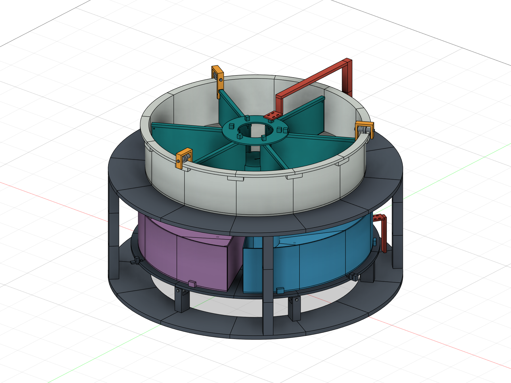

# Bottle Sorter

**In progress: migrating from a three-angle chute to a rotating tray carrying three removable bins.**

This team project combines Arduino Mega stepper control, ESP32-S3 camera classification, and a six-sector upper feeder. The current mechanical direction rotates the three lower bins together so that the selected bin aligns with the fixed drop opening.

## Choose the correct version

| Version | Location | Intended hardware | Status |
|---|---|---|---|
| Legacy real-AI controller | [legacy/chute-v2](legacy/chute-v2) | Old chute at -30 / 0 / +30 degrees | Archived source baseline |
| Manual-result full-flow demo | [demos/full-flow-sim](demos/full-flow-sim) | Old chute; keyboard 1/2/3 replaces AI | Separate demo baseline |
| ESP32 camera and AI | [firmware/esp32](firmware/esp32) | Freenove ESP32-S3 N8R8 + OV3660 | SCAN / RESULT UART interface |
| Three-bin rotating tray | [mechanical](mechanical) | New common tray, nominal 120-degree bin spacing | CAD R0.1; controller adaptation pending |

**Do not run the old chute angles on the new tray.** Output-shaft pulses per revolution, bin alignment, sensor types, and loaded motion must be established for the actual mechanism. No new tray firmware is presented as complete.

## Start here

- [Setup and dependencies](docs/setup.md)
- [Wiring and pin map](hardware/wiring.md)
- [Serial protocol](docs/serial-protocol.md)
- [Legacy demo operation](demos/full-flow-sim/README.md)
- [Three-bin migration plan](docs/three-bin-migration.md)
- [Known limitations](docs/known-issues.md)
- [Contribution workflow](CONTRIBUTING.md)
- [Checks and evidence](tests/README.md)

## Access and versions

The repository is public for viewing and downloading. MrAss0115 maintains the upstream repository; contributors use forks and pull requests. Repository ownership and write access are different from authorship: purchasing, wiring, and development were team work, including joint driver procurement and wiring with Yuan.

`main` is the documented project baseline. The planned development branch is `feature/three-bin-tray`. The legacy source snapshot is retained in `legacy/` and `demos/`; import files are not claimed to exactly reproduce later board-side demo edits.

No project-wide reuse license has been selected. Third-party components retain their own licenses; see [third-party notices](THIRD_PARTY_NOTICES.md).
